# LinkedIn Intelligence and Growth Agent

An evidence-based AI strategist, prospect CRM, content studio, profile optimizer, and Manifest V3 Chrome extension for growing a professional network on LinkedIn. A secure OpenRouter proxy backend and SQLite storage sit underneath it all.


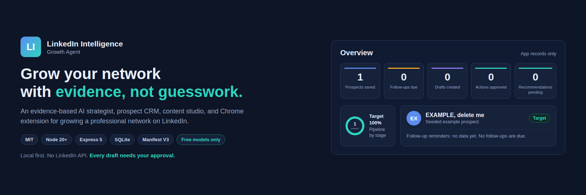

*Designed in HTML and CSS from the real dashboard layout and empty-state numbers. Not a screenshot.*

Built for Saif Ullah, Agentic AI Engineer at TechAurah. LinkedIn: linkedin.com/in/saif-ullah-ai-engineer. Portfolio: saifullah-ai-engineer.me. GitHub: saifullah-ai-engineer.

## Overview

This is a working growth system, not a demo shell. It helps you find the right people on LinkedIn, keep track of real relationships, write contextual drafts, and improve your profile, while every consequential action waits for your approval.

Everything runs locally. The dashboard and the Chrome extension talk only to a Node.js backend on your own machine. The backend stores every record in a local SQLite database and calls OpenRouter through a server-side proxy. The app has no LinkedIn API access and imports no LinkedIn data. All numbers are records you entered in the app.

The AI is evidence-based by design. The strategist reads only real evidence, your saved goals and memory, the prospects and interactions in the database, and text you paste in. Every recommendation shows its reasoning, cites the specific evidence it used, and proposes one specific next action. If the evidence is not enough, it says so plainly instead of inventing an answer.

Free models only. The app uses OpenRouter free models, with a full fallback chain of all 12 free models in order, starting with google/gemma-4-26b-a4b-it:free. Paid models are never used, enforced at three layers: the chat chain accepts only model ids ending in `:free`, the config save rejects anything else with `400 paid_model_not_allowed`, and the dashboard free-only filter is on by default.

## Screenshots

Real screenshots of the running dashboard, taken from the local app. No mockups.

| Overview | AI Strategist |
|---|---|
| 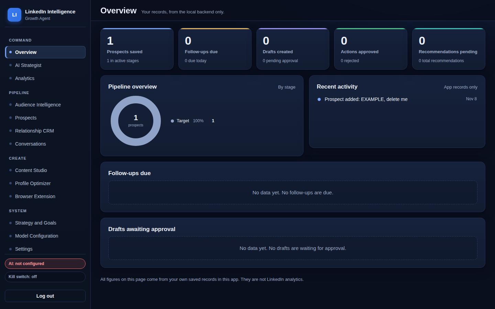 | 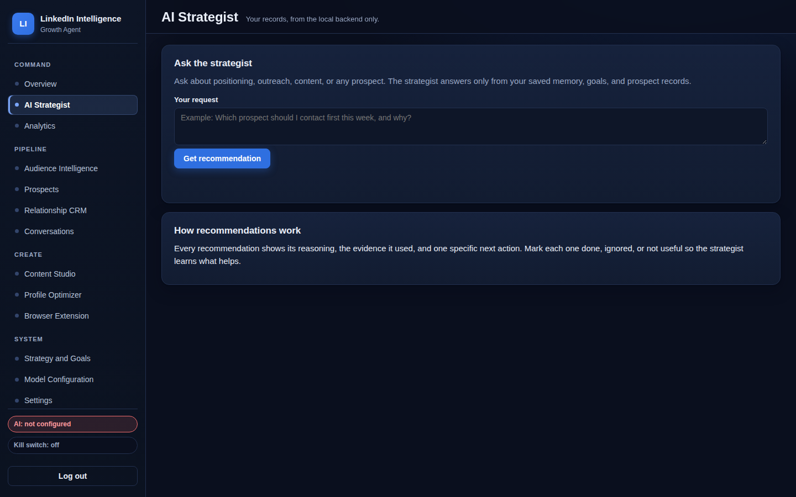 |

| Prospects CRM | Content Studio |
|---|---|
| 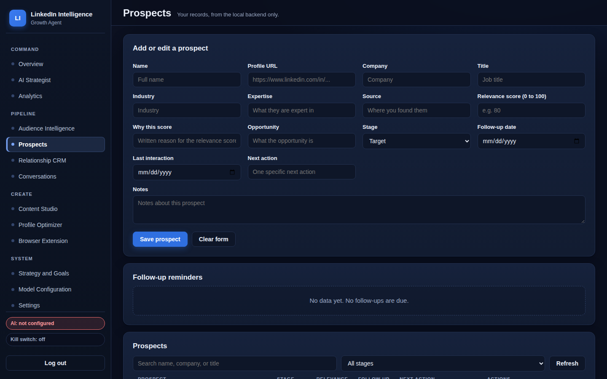 | 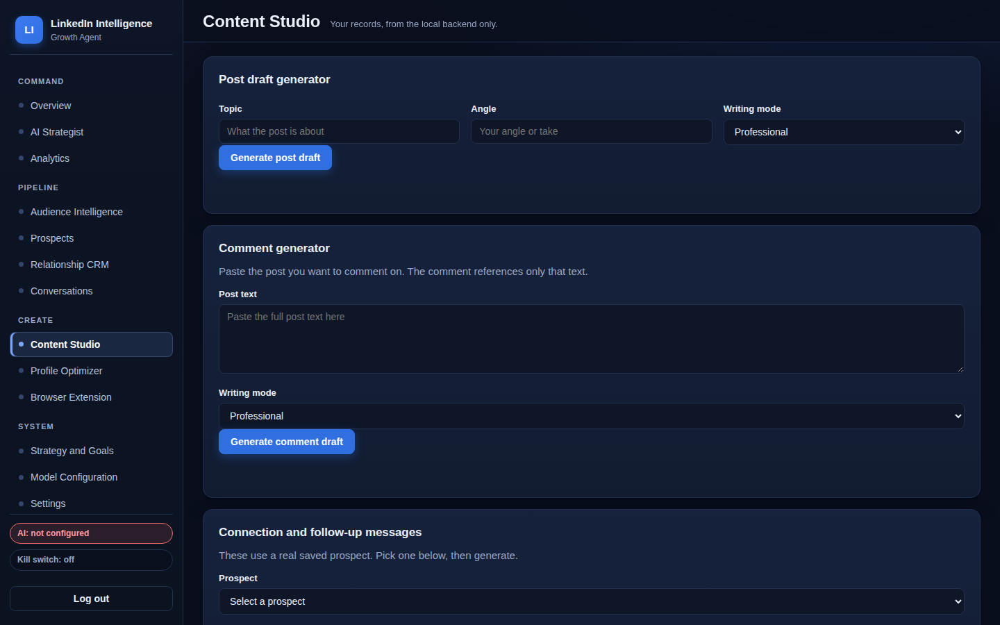 |

| Model Configuration | Analytics |
|---|---|
| 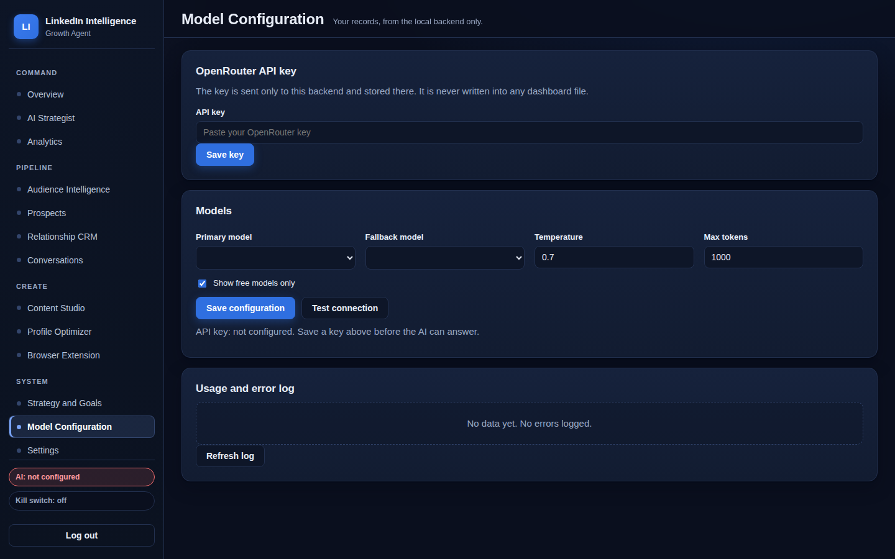 | 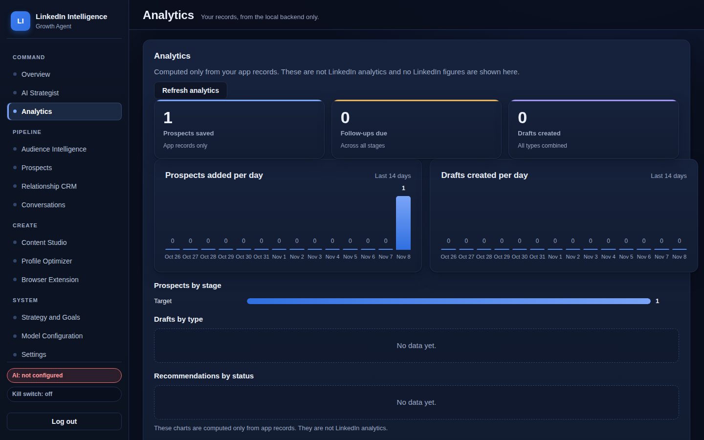 |

## Key features


*Diagram built in HTML and CSS from the real agent modules: Strategist, Audience, Relationship, Content, Outreach, and Profile.*

| Area | What works |
|---|---|
| AI Strategist | Evidence-based recommendations with reasoning, cited evidence, and one specific next action |
| Audience Intelligence | Ranked prospects with written reasons, target audience definitions from memory |
| Prospect CRM | Full create, read, update, and delete, plus interactions, notes, and follow-up reminders |
| Relationship CRM | Per-prospect interaction history, notes, and next-action tracking |
| Conversations | Paste-in summary and follow-up draft suggestions |
| Content Studio | Post, comment, connection, and follow-up draft generators, all approval gated |
| Profile Optimizer | Guided setup, then headline, About, experience, featured, skills, and checklist drafts |
| Browser Extension | Contextual side panel on LinkedIn profile, feed, company, and messaging pages |
| Strategy and Goals | Editable goals and strategic memory the strategist reads |
| Analytics | Real counts from local database rows only, labelled as app records |
| Model Configuration | Live OpenRouter model list, free-model filter, primary and fallback, connection test |
| Compliance | Manual approval, kill switch, audit log, error log |

## Architecture

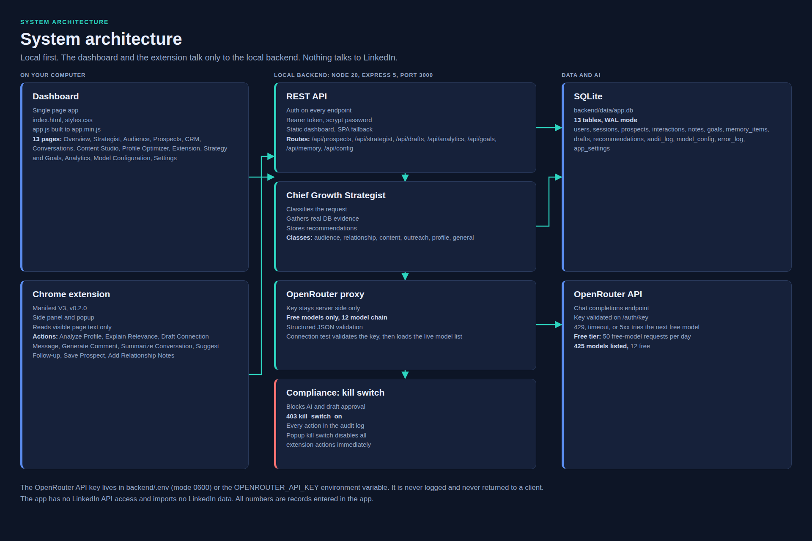

*Designed in HTML and CSS from the real codebase. The precise diagrams are below.*

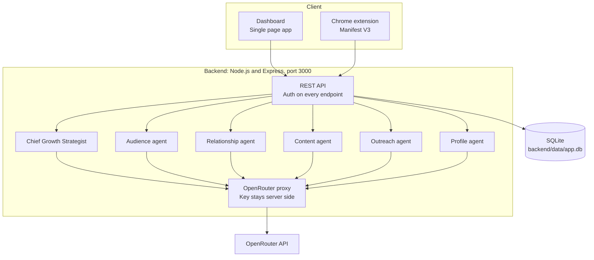

The dashboard and the extension talk only to the local backend, never directly to OpenRouter. The OpenRouter API key lives server side only, in `backend/.env` as `OPENROUTER_API_KEY`. The key is never logged, never returned to any client, and never written into any dashboard file.

Rendered diagrams with more detail live in [docs/architecture/](docs/architecture/):

- [system-architecture.svg](docs/architecture/system-architecture.svg) ([Mermaid source](docs/architecture/system-architecture.mmd)): clients, backend, SQLite, and OpenRouter, with the key flow and the kill switch.
- [component-architecture.svg](docs/architecture/component-architecture.svg) ([Mermaid source](docs/architecture/component-architecture.mmd)): every backend module and its `require()` dependencies, the six agents, and the two clients.
- [prospect-lifecycle.svg](docs/architecture/prospect-lifecycle.svg) ([Mermaid source](docs/architecture/prospect-lifecycle.mmd)): the ten pipeline stages and the ranking formula.
- [draft-approval-flow.svg](docs/architecture/draft-approval-flow.svg) ([Mermaid source](docs/architecture/draft-approval-flow.mmd)): draft generation, approval, rejection, and the kill switch.

### Modules and responsibilities

| Module | Responsibility |
|---|---|
| `backend/server.js` | Express app. All API routes, compression, static dashboard, SPA fallback, `robots.txt`, favicon 204. Listens on port 3000 (`PORT` env). |
| `backend/db.js` | `node:sqlite` setup, WAL mode, 13 tables, seed data, `audit()` and `logError()`. |
| `backend/auth.js` | scrypt password hashing, bearer token sessions, `requireAuth` middleware. |
| `backend/openrouter.js` | OpenRouter client. Key handling, model list with a free flag, the 12 model free fallback chain, structured JSON extraction and validation. |
| `backend/agents/strategist.js` | Orchestrator. Classifies the request, gathers real evidence, builds the system prompt, calls the proxy, stores the recommendation with its evidence. |
| `backend/agents/profile.js` | Prompt section from saved identity facts only. Never invents profile details. |
| `backend/agents/audience.js` | Prompt section from real prospects and goals. |
| `backend/agents/relationship.js` | Prompt section from prospect stages, recorded interactions, notes, and follow-up dates. |
| `backend/agents/content.js` | Prompt section from saved goals, memory items, and existing drafts. |
| `backend/agents/outreach.js` | Prompt section from Target stage prospects, their notes, and recorded interactions. |
| `backend/public/` | Dashboard frontend: `index.html` (13 pages), `styles.css` (design system), `app.js` (source of truth), `app.min.js` (terser build, loaded with defer). |
| `extension/` | Manifest V3 extension, v0.2.0: service worker, content script, popup, side panel. Reads only visible page text, drafts only. |

### Technology stack

| Layer | Technology | Notes |
|---|---|---|
| Runtime | Node.js 20+ | No other runtime needed |
| Backend | Express 5, `compression` | Static dashboard, JSON API, gzip |
| Database | SQLite via built-in `node:sqlite` | `backend/data/app.db`, WAL mode, no native modules |
| Frontend | Plain HTML, CSS, JavaScript | No framework. `app.js` built to `app.min.js` with terser |
| AI | OpenRouter API | Server-side proxy only. Free models only, 12 model fallback chain |
| Extension | Chrome Manifest V3 | Permissions: `activeTab`, `storage`, `sidePanel` |
| CI | GitHub Actions | `npm ci`, build, `node --check`, minified bundle diff check |

## Core workflows

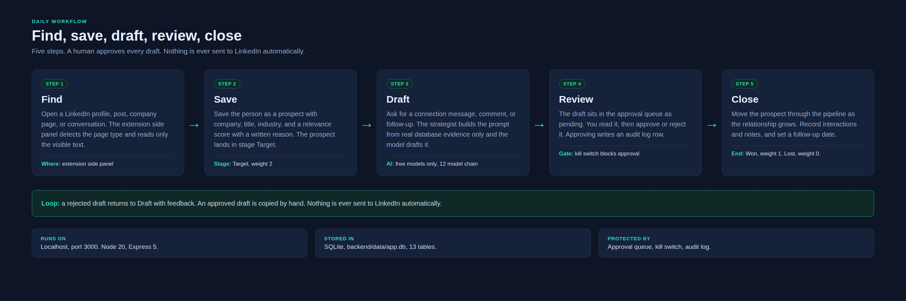

*Designed in HTML and CSS from the real daily workflow. Not a screenshot of the app.*

### Daily workflow

1. **Find**: open a LinkedIn profile, post, company page, or conversation. The extension side panel detects the page type and reads only the visible text you are already viewing.
2. **Save**: save the person as a prospect with company, title, industry, and a relevance score with a written reason. The prospect lands in stage Target.
3. **Draft**: ask for a connection message, comment, or follow-up. The strategist builds the prompt from real database evidence only and the model drafts it.
4. **Review**: the draft sits in the approval queue as pending. You read it, then approve or reject it. Approving writes an audit log row. Nothing is ever sent to LinkedIn by the app or the extension. Copying a draft does not send it.
5. **Close**: move the prospect through the pipeline as the relationship grows, record interactions and notes, and set a follow-up date. The prioritized ranking tells you who needs attention next.

### Prospect lifecycle

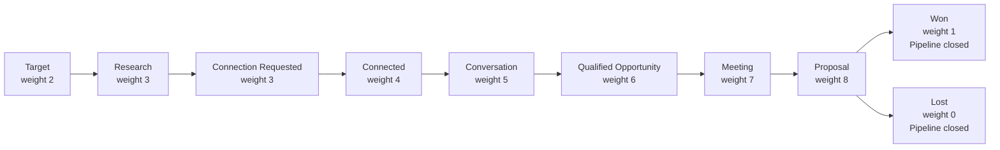

The ranking endpoint is `GET /api/prospects/prioritized`. The score is stage weight x 10, plus relevance score x 0.5, plus 15 for a follow-up due today (or 5 if scheduled), plus 5 for an interaction in the last 14 days. Every rank carries a written reason. Full diagram: [prospect-lifecycle.svg](docs/architecture/prospect-lifecycle.svg).

### Draft approval flow

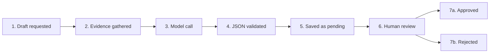

The model call walks the free-model chain on 429, timeout, or 5xx. The reply must be valid structured JSON with a recommendation, reasoning, and evidence, or the backend retries once and then returns a structured error. The kill switch blocks AI generation and draft approval with `403 kill_switch_on`. Full diagram: [draft-approval-flow.svg](docs/architecture/draft-approval-flow.svg).

### Strategist request flow

1. You send a message on the AI Strategist page, optionally with pasted text.
2. `POST /api/strategist` classifies the request by keyword: audience, relationship, content, outreach, profile, or general.
3. The strategist gathers evidence: goals, memory items, prospects, and the last 20 interactions.
4. The five agent sections are built into the system prompt. The prompt instructs the model to use only that evidence and the pasted text.
5. The proxy calls the free-model chain and validates the JSON reply. An invalid reply is retried once.
6. The recommendation is stored with its evidence and next action, and shown with its classification and the model that answered.

### Extension flow

1. Start the backend, log in to the dashboard once, and load the extension unpacked from `extension/`.
2. In the popup, set the backend URL (default `http://localhost:3000`), paste your dashboard login token, and test the connection.
3. On LinkedIn, open the side panel. It detects the page type and offers Analyze Profile, Explain Relevance, Draft Connection Message, Generate Comment, Summarize Conversation, Suggest Follow-up, Save Prospect, and Add Relationship Notes.
4. Every draft needs the "I reviewed this draft" checkbox before Copy is enabled. Save Prospect writes to the backend through `POST /api/prospects`.
5. The popup kill switch disables all extension actions immediately. If the backend is down or no token is set, the panel shows a "Backend: not connected" state and generates no pretend answer.

## Installation and setup

Requirements: Node.js 20 or newer. No other tools needed.

```bash
cd backend
npm install
node server.js
```

Open http://localhost:3000 in a browser.

On first run, set a local password on the setup screen. That password is stored as a scrypt hash in the local SQLite database (`backend/data/app.db`). All API endpoints except setup, login, and status require the login token.

### Add the OpenRouter key

Without a key, every AI feature shows a clear "not configured" state with exact setup steps, and generates no pretend answer. To enable AI:

1. Create an account at https://openrouter.ai and copy your API key.
2. In the dashboard, open Model Configuration and paste the key, or set `OPENROUTER_API_KEY` in `backend/.env`.
3. Click Test connection. The test validates the key against OpenRouter's authenticated key endpoint, then loads the live model list.
4. Pick a primary model and a fallback model, set temperature and token limits, and save.

The model list is fetched live from OpenRouter through the backend proxy. The free-model filter shows only models with a zero prompt price. The app uses free models only, with a full fallback chain of all 12 free models in order, starting with google/gemma-4-26b-a4b-it:free. On a 429, timeout, or unavailable model, the backend walks the whole chain, then returns a structured error that the UI displays honestly. Errors are recorded in the error log.

### Load the Chrome extension

1. Start the backend first, then log in to the dashboard once so you have a token.
2. Open chrome://extensions, turn on Developer mode, click Load unpacked, and select the `extension/` folder.
3. Open the extension popup, set the backend URL (default http://localhost:3000), paste your dashboard login token, and click Test backend connection.
4. On LinkedIn, open the side panel. It detects the page type (profile, feed post, company, messaging), reads only the visible text you are already viewing, and offers: Analyze Profile, Explain Relevance, Draft Connection Message, Generate Comment, Summarize Conversation, Suggest Follow-up, Save Prospect, Add Relationship Notes.
5. Every draft needs the "I reviewed this draft" checkbox before Copy is enabled. Copying does not send anything. Save Prospect writes to the backend database through the API.

If the backend is down or no token is set, the panel shows a "Backend: not connected" state with setup steps and generates no pretend answer. The popup has a kill switch that disables all extension actions immediately.

### Environment variables

| Variable | Required | Default | Notes |
|---|---|---|---|
| `OPENROUTER_API_KEY` | Yes, for AI features | None | Set in `backend/.env` (file mode 0600) or the environment. Never committed. See `backend/.env.example`. |
| `PORT` | No | `3000` | Port the backend listens on. The extension host permission covers `http://localhost:3000/*`; a different port needs a matching manifest change. |
| `LIGA_DATA_DIR` | No | `backend/data` | Where the SQLite database lives. Used by the test suite to run against a throwaway directory. |

### Development commands

Run from the `backend/` folder:

```bash
npm start             # same as node server.js
npm run build         # rebuild public/app.min.js from public/app.js with terser
npm test              # run the automated API test suite (10 tests, about 5 seconds)
node --check server.js
node --check openrouter.js
node --check db.js
for f in agents/*.js; do node --check "$f"; done
for f in ../extension/*.js; do node --check "$f"; done
```

After editing `app.js`, always run `npm run build`. The readable `app.js` stays in the repo as the source of truth, and CI fails if the committed `app.min.js` does not match a fresh build. After editing extension files, press Reload on the extension card at chrome://extensions.

### Usage examples

Log in and keep the token:

```bash
curl -X POST http://localhost:3000/api/auth/login \
  -H "Content-Type: application/json" \
  -d '{"password": "your-password"}'
```

List prospects:

```bash
curl http://localhost:3000/api/prospects \
  -H "Authorization: Bearer <token>"
```

Ask the strategist:

```bash
curl -X POST http://localhost:3000/api/strategist \
  -H "Authorization: Bearer <token>" \
  -H "Content-Type: application/json" \
  -d '{"message": "What should I focus on this week?"}'
```

See the analytics (app records only, not LinkedIn analytics):

```bash
curl http://localhost:3000/api/analytics \
  -H "Authorization: Bearer <token>"
```

Full endpoint list: `backend/README.md`.

### Testing

The backend has a real automated API test suite now: `backend/test/api.test.js`, run with `npm test` from the `backend` folder. It uses Node's built-in test runner, no extra dependency, and starts the real server as a child process against a throwaway data directory, so it never touches a real database or a real key. 10 tests, all passing, in about 5 seconds, covering auth and setup, config validation including the paid-model rejection, the not-configured AI responses, prospect CRUD and prioritized ranking, interactions and notes, goals, memory, drafts and approval, the kill switch, recommendations, analytics, audit, and errors.

Verification is done in three ways:

1. **CI on every push**: `.github/workflows/ci.yml` runs `npm ci`, `npm run build`, `npm test`, `node --check` on `server.js`, `openrouter.js`, `db.js`, every agent module, and every extension script, then fails if the committed minified bundle differs from a fresh build, and fails if any README contains placeholder text such as `your-username` or `<YOUR_GIT_URL>`. CI runs on Node 24, since `node:sqlite` needs Node 22.5 or newer.
2. **Manual smoke check**: start the server, open http://localhost:3000, set the first-run password, create a prospect, open Analytics, and confirm the counts change. With no OpenRouter key, the AI pages must show the not-configured state and generate no answer. A full browser run of all 13 pages, including setup, prospect creation, CRM interactions and notes, goal creation, draft approval, kill switch, and logout, passes with no console errors.
3. **Measured performance, 2026-11-09, Lighthouse 13.6.0, real runs after the upgrade**: setup screen 100 Performance, 100 Accessibility, 100 Best Practices, 100 SEO on the first run and 99 Performance with 100 in the other three on the second run. Authenticated dashboard 100 in all four categories on the first run and 95 Performance with 100 in the other three on the second run. Backend API p50 1.4 to 3.0 ms and p95 2.6 to 6.9 ms across the ten main endpoints (20 runs each).

### Deployment

There is no hosted deployment. This is a local app by design: the backend runs on your own machine, the database lives in `backend/data/app.db`, and the extension talks to `http://localhost:3000`. To run it, start the backend with `node server.js` and keep that terminal open. Do not expose port 3000 to the internet; the login is a single local password, not a multi-user auth system.

### Security considerations

- **Local password**: the first-run password is hashed with scrypt and stored in the local database. There is no password reset. If you lose it, delete `backend/data/app.db` to reset the app to first-run setup, which also deletes all prospects, drafts, and memory.
- **Bearer tokens**: login returns a token stored in `sessionStorage` by the dashboard and in `chrome.storage.local` by the extension. Log out to delete the server-side session row.
- **API key**: the OpenRouter key lives server side only, in `backend/.env` (written with mode 0600) or the `OPENROUTER_API_KEY` environment variable. It is never logged, never returned by any API response, and never written into any dashboard file. The extension never holds it.
- **Auth on every route**: every `/api/*` endpoint except status, setup, and login requires the bearer token. The kill switch blocks AI and draft approval with `403 kill_switch_on`.
- **Audit and error logs**: approving or rejecting a draft, deleting a prospect, goal, or memory item, changing config, and toggling the kill switch each write an `audit_log` row, viewable in Settings. Failures are written to `error_log`.
- **No LinkedIn automation**: the app never sends anything to LinkedIn, and the extension never clicks, likes, connects, or messages for you. That is intentional and protects the account.

### Contributing

1. Fork the repo and work on a branch. Keep the no em dash rule: never use an em dash in code, comments, or docs.
2. Keep every claim honest. Do not add invented stars, users, results, or LinkedIn stats. Analytics counts come only from real database rows.
3. Keep free models only. Never add a paid model to the chain, the config, or the UI.
4. After editing `app.js`, run `npm run build` so the committed bundle matches.
5. Check that CI passes on your pull request. Add no feature that sends anything to LinkedIn automatically.

### Roadmap

Ideas, not commitments. Nothing here is promised or scheduled.

- Live AI verification end to end once the OpenRouter key is configured in the backend.
- More dashboard screenshots as new pages are added.
- Optional export of prospects and drafts to CSV from the dashboard.

## Project structure

```
linkedin-growth-agent/
  README.md                 This file
  LICENSE                   MIT
  .gitignore
  LOCKED-STATE.md           Frozen reference of the locked state, 2026-11-09
  CONTRIBUTING.md           How to contribute, including the rules that do not change
  SECURITY.md               How to report a security problem
  .github/
    workflows/
      ci.yml                GitHub Actions: npm ci, build, test, node --check, README check
    dependabot.yml          Weekly npm updates for the backend
    ISSUE_TEMPLATE/
      bug_report.md, feature_request.md
    PULL_REQUEST_TEMPLATE.md
  docs/
    images/                 HTML and CSS visuals, plus the rendered repo diagram
      hero.png, agents.png, architecture-overview.png,
      user-workflow.png, repo-structure.png
    screenshots/            Real dashboard screenshots (overview, strategist,
                            prospects, content-studio, model-config, analytics)
    architecture/           Mermaid source plus rendered SVG diagrams
      system-architecture, component-architecture,
      prospect-lifecycle, draft-approval-flow
    repository-structure/
      directory-tree.txt    Full file list with one line purposes
      repository-map.svg    Graphical map of the folders
    video/                  Promo video work in flight, not part of the app
  backend/                  Node.js and Express backend
    server.js               All API routes, serves the dashboard
    db.js                   SQLite schema, seed data, audit and error logging
    auth.js                 Local login, scrypt password hashing, bearer tokens
    openrouter.js           OpenRouter client, key handling, fallback, structured JSON
    test/
      api.test.js           Automated API test suite, Node built-in test runner
    agents/                 Six real agent modules: strategist, audience,
                            relationship, content, outreach, profile
    public/                 Dashboard frontend (index.html, styles.css, app.js)
    .env.example            Key name only, no value
  extension/                Chrome extension, Manifest V3
    manifest.json, background.js, content.js,
    popup.html, popup.js, sidepanel.html, sidepanel.js
```

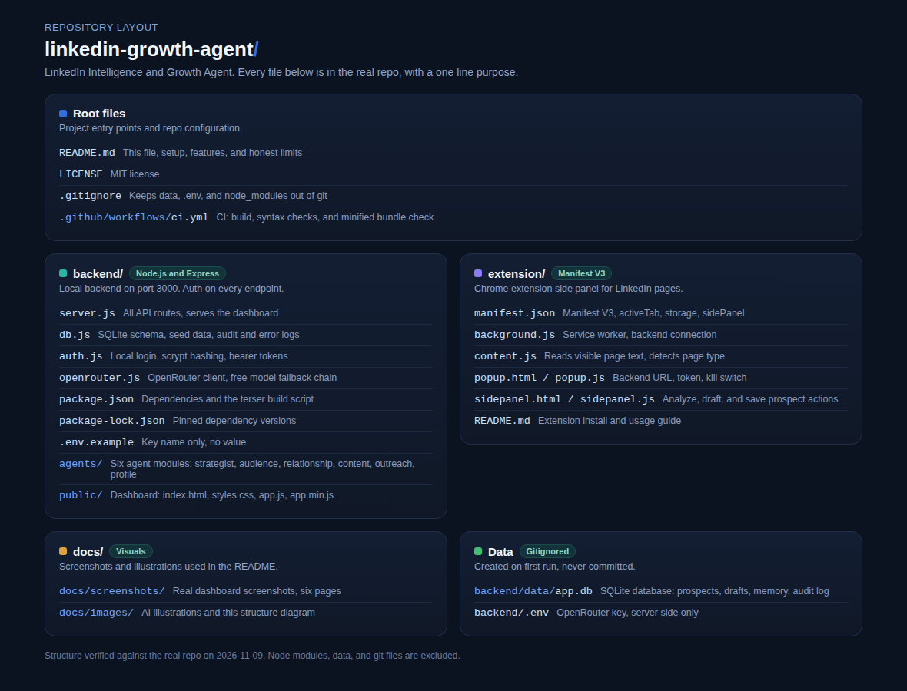

*Rendered diagram of the real repo layout. The text tree above lists the same files. Full file list: [docs/repository-structure/directory-tree.txt](docs/repository-structure/directory-tree.txt). Graphical map: [docs/repository-structure/repository-map.svg](docs/repository-structure/repository-map.svg).*

## Data

Everything lives in `backend/data/app.db` (SQLite). Tables: users, sessions, prospects, interactions, notes, goals, memory_items, drafts, recommendations, audit_log, model_config, error_log, app_settings. Delete the file to reset the app to first-run setup. The file is gitignored and is never committed.

On first run, with empty tables, the database seeds seven real memory items (identity, LinkedIn, portfolio, GitHub, services, target audiences, positioning) and three goals derived from them. It seeds zero fake prospects. It seeds one example prospect named "EXAMPLE, delete me" in stage Target so the UI empty state and pipeline can be demonstrated. Delete that row before real use.

## Upgrade notes, 2026-11-09

A full end-to-end verification found and fixed six real bugs, all re-tested after the fix:

1. **First-run setup bounced new users to the login screen.** Setup returned no token, so the dashboard entered the app with no session and was signed straight back out. Setup now returns a bearer token and signs the user in directly.
2. **Goals could not be saved from the dashboard.** The goal form sends title, target, deadline, status, and description, but the API only accepted a text field and answered 400. The goals table gained those columns (existing databases migrate on first start), and the API accepts the dashboard shape. Older rows with only text still read back with the title set from the text.
3. **Interactions were saved empty and never shown.** The interaction form sent type, date, and summary, but the API stored kind and text, so every interaction saved with no kind and no text. There was also no endpoint to list a prospect's interactions, so the CRM log was always empty. The API now accepts both field shapes, stores the date as happened_on, and `GET /api/prospects/:id/interactions` lists them. The CRM page reads from that endpoint.
4. **AI pages showed a bare error code instead of the setup steps.** The not-configured 503 was thrown as a plain error, so the friendly guidance never rendered. API errors now carry their response body, and every AI form shows the setup steps when no key is configured.
5. **Config accepted impossible values.** Temperature 99 and max tokens -5 saved without complaint. The API now rejects a temperature outside 0 to 2 and max tokens outside 100 to 32000 with 400.
6. **Logout never told the server.** Signing out only cleared the browser token, so session rows piled up in the database. Logout now deletes the server-side session, and still signs out locally if that call fails.

Other changes in the same upgrade: an automated API test suite (`backend/test/api.test.js`, 10 tests, about 5 seconds, also in CI), CI moved to Node 24 with a README placeholder check, issue and pull request templates, CONTRIBUTING.md, SECURITY.md, Dependabot for the backend, the root `.gitignore` now covers `data/`, and `/api/analytics` returns `totalDrafts` so the Analytics page no longer relies on a possibly stale dashboard cache. The dashboard now loads its two cache calls in parallel on the Content Studio page and the Analytics refresh. Nothing about the free-models-only chain, the extension permissions, or the honest limits changed.

Measured after the upgrade: API p50 1.4 to 3.0 ms and p95 2.6 to 6.9 ms across the ten main endpoints (20 runs each, before: p50 1.0 to 1.9 ms, p95 1.3 to 12.0 ms). The API was already fast; the change is within run-to-run noise, not a speedup. Bundle sizes: `app.min.js` 49,270 bytes (12,560 bytes gzipped on the wire), `styles.css` 19,814 bytes (5,119 bytes gzipped). CSS minification was measured and skipped: it would save about 1 KB on the wire, not worth a new build dependency. Lighthouse 13.6.0 after the upgrade, two real runs: first run setup 100/100/100/100 and dashboard 100/100/100/100; second run setup 99/100/100/100 and dashboard 95/100/100/100. All four categories stay at 90 or above.

## Honest limits

- **Needs an OpenRouter key**: AI Strategist, all draft generation, profile generation, model list, and connection test. Without a key they show their not-configured state and do nothing else. The key itself is connected and verified valid, but it still needs to be entered in the backend's own Model Configuration page or `backend/.env` before live AI can be verified end to end.
- **Needs manual approval**: every draft, every profile change, and every message. The app never sends anything to LinkedIn, and the extension never clicks, likes, connects, or messages for you.
- **Needs a running backend**: the dashboard and the extension both talk to the local backend on port 3000. If it is not running, the dashboard shows a "backend not running" screen with the start command.
- **No LinkedIn data**: the app has no LinkedIn API access and imports no LinkedIn data. All numbers are records you entered in the app. Prospects, interactions, and notes are entered by you or saved from a page you are viewing.
- **No bulk automation**: bulk connections, auto likes, auto comments, auto messages, scraping hidden data, and CAPTCHA bypass are intentionally not built. They are against LinkedIn's rules and would put the account at risk.
- **Free tier limits**: the OpenRouter key is free tier, 50 free-model requests per day. Two live chat attempts on 2026-11-09 returned HTTP 429 from account-level free-tier throttling. The fallback chain walks all 12 free models, then returns a structured rate-limited error instead of a fake answer.

## License

MIT. See LICENSE.
