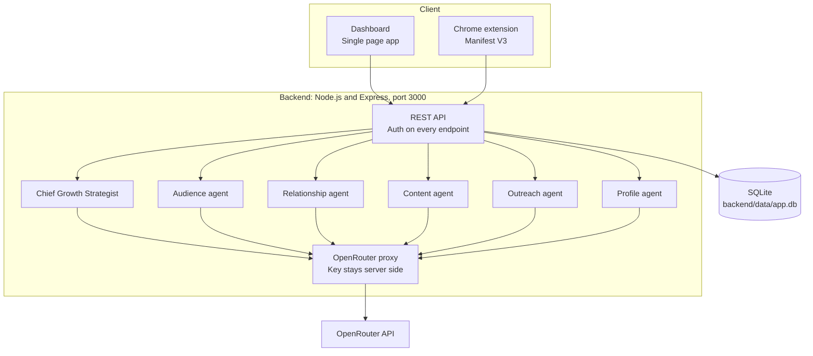

# LinkedIn Intelligence and Growth Agent

An evidence-based AI strategist, prospect CRM, content studio, profile optimizer, and Manifest V3 Chrome extension for growing a professional network on LinkedIn. A secure OpenRouter proxy backend and SQLite storage sit underneath it all.


Built for Saif Ullah, Agentic AI Engineer at TechAurah. LinkedIn: linkedin.com/in/saif-ullah-ai-engineer. Portfolio: saifullah-ai-engineer.me. GitHub: saifullah-ai-engineer.

## Screenshots

Real screenshots of the running dashboard, taken from the local app. No mockups.

| Overview | AI Strategist |
|---|---|
|  |  |

| Prospects CRM | Content Studio |
|---|---|
|  |  |

| Model Configuration |
|---|
|  |

## What it does

This is a working growth system, not a demo shell. It helps you find the right people on LinkedIn, keep track of real relationships, write contextual drafts, and improve your profile, while every consequential action waits for your approval.

- **AI Strategist**: an evidence-based growth consultant. It reads only real evidence, your saved goals and memory, the prospects and interactions in the database, and text you paste in. Every recommendation shows its reasoning, cites the specific evidence it used, and proposes one specific next action. Recommendations can be marked done, ignored, or not useful, and that outcome is recorded and used later.
- **Prospect CRM**: prospects with company, title, industry, expertise, source, relevance score with a written reason, opportunity, stage, interaction history, notes, last interaction, next action, and follow-up date. Prospects are ranked by stage, relevance score, recency, and follow-up date, with a written reason for each rank.
- **Content Studio**: post drafts, comments, connection messages, and follow-up messages. Comments require pasted post text and reference only what is in that text. Messages use a real prospect's details only. Every draft goes to an approval queue. Nothing is ever sent anywhere automatically.
- **Profile Optimizer**: guided setup for identity, expertise, objectives, services, projects, achievements, certifications, target industries, and markets, then generates headline, About section, experience bullets, featured strategy, skills, and a checklist as editable drafts.
- **Audience Intelligence**: ranked prospects with reasons, plus target audience definitions from your saved memory.
- **Conversations**: paste conversation text and get a summary plus a suggested follow-up draft.
- **Strategy and Goals**: editable goals, audiences, positioning, communication style, offerings, and brand strategy, saved as strategic memory the strategist actually reads. Every memory item can be inspected, edited, and deleted.
- **Analytics**: figures computed only from the app's own database rows (prospects by stage, follow-ups due, drafts by type and status), clearly labelled as app records, not LinkedIn analytics.
- **Model Configuration**: live OpenRouter model list through the backend proxy, free-model filter, primary and fallback model, temperature and token limits, connection test, usage and error log.
- **Compliance engine**: every consequential action needs explicit approval, a kill switch disables all AI and drafting actions, and every approved or blocked action is written to an audit log.

## Features

| Area | What works |
|---|---|
| AI Strategist | Evidence-based recommendations with reasoning, cited evidence, and one specific next action |
| Audience Intelligence | Ranked prospects with written reasons, target audience definitions from memory |
| Prospect CRM | Full create, read, update, and delete, plus interactions, notes, and follow-up reminders |
| Relationship CRM | Per-prospect interaction history, notes, and next-action tracking |
| Conversations | Paste-in summary and follow-up draft suggestions |
| Content Studio | Post, comment, connection, and follow-up draft generators, all approval gated |
| Profile Optimizer | Guided setup, then headline, About, experience, featured, skills, and checklist drafts |
| Browser Extension | Contextual side panel on LinkedIn profile, feed, company, and messaging pages |
| Strategy and Goals | Editable goals and strategic memory the strategist reads |
| Analytics | Real counts from local database rows only, labelled as app records |
| Model Configuration | Live OpenRouter model list, free-model filter, primary and fallback, connection test |
| Compliance | Manual approval, kill switch, audit log, error log |

## Architecture



The dashboard and the extension talk only to the local backend, never directly to OpenRouter. The OpenRouter API key lives server side only, in `backend/.env` as `OPENROUTER_API_KEY`. The key is never logged, never returned to any client, and never written into any dashboard file.

## Quick start

Requirements: Node.js 20 or newer. No other tools needed.

```bash
cd backend
npm install
node server.js
```

Open http://localhost:3000 in a browser.

On first run, set a local password on the setup screen. That password is stored as a scrypt hash in the local SQLite database (`backend/data/app.db`). All API endpoints except setup, login, and status require the login token.

## Add the OpenRouter key

Without a key, every AI feature shows a clear "not configured" state with exact setup steps, and generates no pretend answer. To enable AI:

1. Create an account at https://openrouter.ai and copy your API key.
2. In the dashboard, open Model Configuration and paste the key, or set `OPENROUTER_API_KEY` in `backend/.env`.
3. Click Test connection. The test validates the key against OpenRouter's authenticated key endpoint, then loads the live model list.
4. Pick a primary model and a fallback model, set temperature and token limits, and save.

The model list is fetched live from OpenRouter through the backend proxy. The free-model filter shows only models with a zero prompt price. The app uses free models only, with a full fallback chain of all 12 free models in order, starting with google/gemma-4-26b-a4b-it:free. On a 429, timeout, or unavailable model, the backend walks the whole chain, then returns a structured error that the UI displays honestly. Errors are recorded in the error log.

## Load the Chrome extension

1. Start the backend first, then log in to the dashboard once so you have a token.
2. Open chrome://extensions, turn on Developer mode, click Load unpacked, and select the `extension/` folder.
3. Open the extension popup, set the backend URL (default http://localhost:3000), paste your dashboard login token, and click Test backend connection.
4. On LinkedIn, open the side panel. It detects the page type (profile, feed post, company, messaging), reads only the visible text you are already viewing, and offers: Analyze Profile, Explain Relevance, Draft Connection Message, Generate Comment, Summarize Conversation, Suggest Follow-up, Save Prospect, Add Relationship Notes.
5. Every draft needs the "I reviewed this draft" checkbox before Copy is enabled. Copying does not send anything. Save Prospect writes to the backend database through the API.

If the backend is down or no token is set, the panel shows a "Backend: not connected" state with setup steps and generates no pretend answer. The popup has a kill switch that disables all extension actions immediately.

## Project structure

```
linkedin-growth-agent/
  README.md                 This file
  LICENSE                   MIT
  .gitignore
  docs/
    screenshots/            Real dashboard screenshots (overview, strategist,
                            prospects, content-studio, model-config)
  backend/                  Node.js and Express backend
    server.js               All API routes, serves the dashboard
    db.js                   SQLite schema, seed data, audit and error logging
    auth.js                 Local login, scrypt password hashing, bearer tokens
    openrouter.js           OpenRouter client, key handling, fallback, structured JSON
    agents/                 Six real agent modules: strategist, audience,
                            relationship, content, outreach, profile
    public/                 Dashboard frontend (index.html, styles.css, app.js)
    .env.example            Key name only, no value
  extension/                Chrome extension, Manifest V3
    manifest.json, background.js, content.js,
    popup.html, popup.js, sidepanel.html, sidepanel.js
```

## Data

Everything lives in `backend/data/app.db` (SQLite). Tables: users, sessions, prospects, interactions, notes, goals, memory_items, drafts, recommendations, audit_log, model_config, error_log. Delete the file to reset the app to first-run setup. The file is gitignored and is never committed.

## Honest limits

- **Needs an OpenRouter key**: AI Strategist, all draft generation, profile generation, model list, and connection test. Without a key they show their not-configured state and do nothing else.
- **Needs manual approval**: every draft, every profile change, and every message. The app never sends anything to LinkedIn, and the extension never clicks, likes, connects, or messages for you.
- **Needs a running backend**: the dashboard and the extension both talk to the local backend on port 3000. If it is not running, the dashboard shows a "backend not running" screen with the start command.
- **No LinkedIn data**: the app has no LinkedIn API access and imports no LinkedIn data. All numbers are records you entered in the app. Prospects, interactions, and notes are entered by you or saved from a page you are viewing.
- **No bulk automation**: bulk connections, auto likes, auto comments, auto messages, scraping hidden data, and CAPTCHA bypass are intentionally not built. They are against LinkedIn's rules and would put the account at risk.

## License

MIT. See LICENSE.
